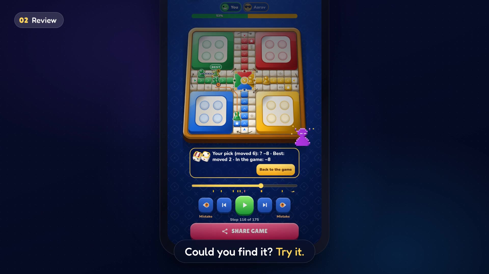
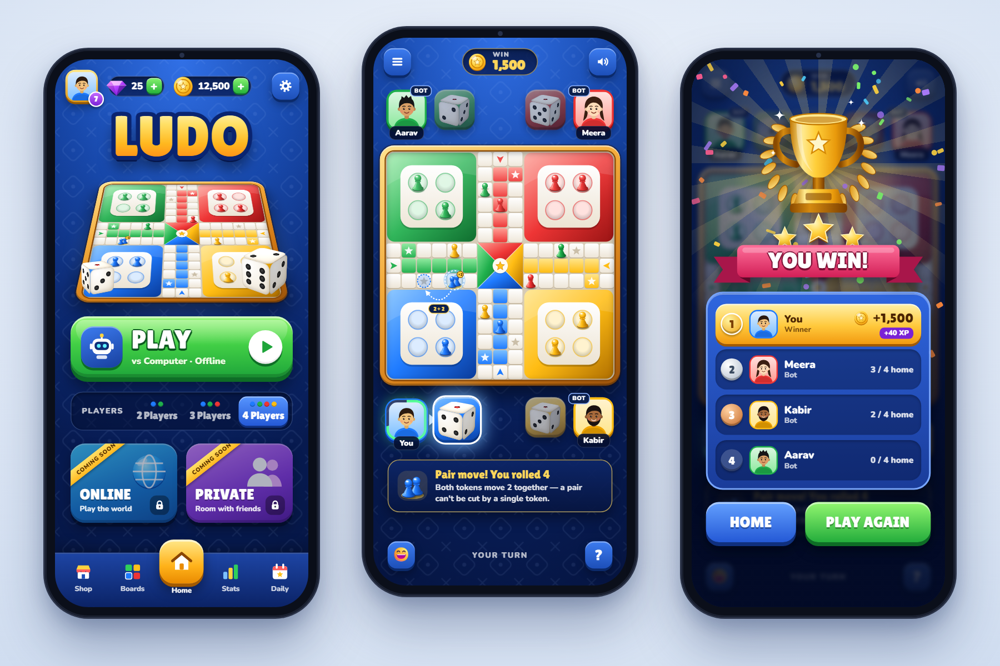

# Tag Team Ludo

[](https://github.com/JuteBags/Tag-Team-Ludo/actions/workflows/build.yml)

**Tag Team Ludo** is classic Ludo against computer players or friends, plus the **pair move** (jodi): two of your tokens on one square move together and block the way. One HTML5 codebase runs in the browser, on Android and on Windows. Current version: **2.5.0** ([release notes](release-notes/2.5.0.md)).

- **Website:** https://jutebags.github.io/Tag-Team-Ludo/
- **Play in the browser:** https://jutebags.github.io/Tag-Team-Ludo/play/
- **Download the APK:** https://jutebags.github.io/Tag-Team-Ludo/download/tag-team-ludo.apk (Android 7.0 or newer)
- **Versioned releases** (APK, AAB and a portable Windows `.exe`): https://github.com/JuteBags/Tag-Team-Ludo/releases

[](https://github.com/JuteBags/Tag-Team-Ludo/releases/download/v2.5.0/tag-team-ludo-demo.mp4)

▶ **[Watch the 37-second demo](https://github.com/JuteBags/Tag-Team-Ludo/releases/download/v2.5.0/tag-team-ludo-demo.mp4)** (MP4, 1080p, captioned for sound-off). How it's made: [marketing/demo-film](marketing/demo-film/TREATMENT.md).



## What's in the game

### Play
- Two offline modes: **vs Computer** (you against 1-3 bots) and **With friends** (2-4 people passing one phone; "Pass the phone" shows once per person, in the first round).
- Roll for order, then pick your house, or tap a house to choose your colour vs Computer. In 2-player games each person can take two colours, opposite or side by side, and from 4 players you can start a team game: you and one bot with two colours each.
- Classic rules: a 6 brings a token out and rolls again, captures send tokens home, stars are safe, exact roll to finish.
- Roll your whole turn first: every 6 rolls again and the dice wait in a tray, then you play them in any order on any token. A kill rolls again right away.
- The pair move: on an even roll a pair moves half the roll each (4 → 2 + 2). Single tokens can't jump an enemy pair (they can stop on it), and only a pair can cut a pair. Prefer classic Ludo? Turn **Doubles** off in Settings.
- A board that shows the way: arrows at every turn, a marker where every possible move lands, and big numbered buttons when moves crowd one spot.
- Keep playing or stop: when someone finishes, the players still in vote on whether to play on for the next place.
- Continue an unfinished game, even after the app was closed. Closing the app can't undo a bad roll. Giving up vs Computer after the first round counts as a loss, and the game warns you first.

### Bots
- **Four levels: Easy, Normal, Hard and Extreme**, each a step up from the one before, with a line under the picker on how each one plays. Harder bots pay more gold.
- **Extreme** plays every option out many times on a WebAssembly engine in a background thread, so the game stays smooth while it thinks.

### Game review and replays
- **Review every game**, like a chess app's game review:
  - a verdict for each of your moves (Best, Good, Inaccuracy, Mistake, Blunder);
  - your accuracy (how much of what was at stake you kept) and your key mistakes;
  - a luck score for everyone, so you know if it was you or the dice;
  - a graph of your winning chances with the turning point;
  - a one-line story of the game.
- **Key moves first:** the moves that cost the most come first, each with the better move.
- **Reviews run by themselves** while the app is open, biggest decisions first, and are saved with the game.
- **Best moves on the board:** step through the replay with your move next to the best one, jump from mistake to mistake, and watch everyone's winning chances in a bar above the board.
- **Find the better move:** on one of your mistakes, try to find the better move before the answer is shown.
- **Anyone's side:** see the review from another player's point of view, the bots' too.
- **Replays and share links:** watch any of your last 20 games again (Stats → Games & reviews), or share a game as a link that plays in the browser. Shared links show colours instead of people's names.

### Rewards and the store
- **Gold** for every game (more against harder bots), for achievements, and for a **daily check-in** that grows over a 7-day streak.
- **Achievements**, including a ladder for beating each level and big rewards for 3, 5 and 7 wins in a row against Extreme.
- **The store:** pawns, dice, dice throwers and boards bought with gold, plus two skins you can only earn: Inferno dice (5 Extreme wins in a row) and Crowned pawns (7).

### Look, feel and access
- A glossy 2.5D look drawn in vector code (SVG + CSS 3D dice), sharp on any screen with a small app.
- Rolls and kills with feel: dice throws, kill finishers (full, short or off in Settings), banners, sounds and vibration, and the palace: each colour's tokens are welcomed home with a short cutscene.
- Boards (Classic, Wooden, Dark, plus store boards), colour-blind symbols (● ▲ ■ ◆), fast bots, reduced motion respected, and an update prompt when a newer version is out.

Online play and private rooms are planned for a later update.

## Development

Needs Node 24.

```bash
npm install
npm run dev        # game at http://localhost:5173
npm test           # rules, dice, replay, review and bot tests
npm run sim        # the long all-bot simulations (~40,000 games: kills, idle rolls, game length; minutes)
npm run build      # typecheck + production build to dist/
```

To open the Android project in Android Studio: `npm run build`, then `npx cap sync android`, then open `android/`.

The Extreme bot and the game review run on a Rust engine (`sim-rs/`) compiled to WebAssembly (`sim-wasm/` → `src/engine/ai/ludo_wasm.wasm`). The module is built by the **WebAssembly engine** workflow on GitHub Actions with a pinned toolchain, and the result is committed. You don't need Rust installed to work on the game. Long engine jobs (arenas, calibrations, speed tests) also run as workflows rather than locally:

| Workflow | What it does |
|---|---|
| `build.yml` | Tests, web build, APK; deploys and releases on a version tag (see below) |
| `sim.yml` | All-bot simulations on every PR, compared with `main` in a PR comment |
| `ai-levels.yml` | Checks each bot level still beats the one below, on PRs that touch the engine |
| `wasm.yml` | Builds and tests the WebAssembly engine |
| `review-calibration.yml`, `review-speed.yml` | Run by hand, or on pushing a `calib/*` or `speed/*` branch: calibrate the review's labels (`tools/ai/REVIEW_CALIB.md`) and measure its speed (`tools/ai/review_speed.ts`) on bot games |

## Project layout

| Path | What it is |
|---|---|
| `src/engine/` | Pure rules engine: moves, pairs and blocks, dice, turn flow, game records; `src/engine/ai/` holds the bot levels and the game review |
| `src/ui/` | Game UI (DOM + SVG) driven by the engine |
| `tests/` | Vitest specs; `tests/sim/` the long all-bot simulations |
| `sim-rs/`, `sim-wasm/` | The Rust engine behind Extreme and the review, and its WebAssembly build |
| `tools/ai/` | Bot and review tooling: arena, calibration, speed tests, the level tables (`LEVELS.md`) |
| `release-notes/` | Player-facing notes for each release |
| `desktop/` | The Electron shell for the Windows `.exe` |
| `android/` | Capacitor Android project (`com.jutebags.ludo`) |
| `docs/` | The website, published to GitHub Pages; `docs/RULES.md` is the full rules spec |
| `assets/` | App icon sources (`tools/render-icons.ps1` renders them) |
| `mockups/` | Original UI mockups |

See [AGENTS.md](AGENTS.md) for architecture notes and conventions.

## Build and release

[`.github/workflows/build.yml`](.github/workflows/build.yml) tests and builds every push to `main` and every pull request, and **deploys on a version tag or when someone runs it by hand**:

| Trigger | Result |
|---|---|
| Push to `main`, pull request | Tests, web build and a signed APK as run artifacts. **Nothing is deployed.** PRs also get the simulation comparison comment ([`sim.yml`](.github/workflows/sim.yml)) |
| Push a tag `v1.2.3` | The same, then deploys the website with the game at `/play/` and the APK at `/download/tag-team-ludo.apk`, and publishes GitHub Release `v1.2.3` with the signed APK, AAB and Windows `.exe`. The tag must match `version` in `package.json`, and `release-notes/1.2.3.md` must exist |
| Run by hand on `main` | Deploys the latest `main`, or any exact commit given as `commit`. If `package.json` has a version with no `v<version>` tag yet and `release-notes/<version>.md` exists, it also publishes GitHub Release `v<version>`, tagged on the commit it built |
| Run by hand on another branch | Build only (including the Windows `.exe`), nothing deployed |

To release a new version: bump `version` in `package.json` and add `release-notes/<version>.md` in a PR, merge it, then tag the merged commit:

```bash
git tag v1.0.1 origin/main
git push origin v1.0.1
```

Or run it from Actions → Build and deploy → Run workflow (Use workflow from: `main`):

```bash
# Deploy the latest main (and release it if its version is new and has notes)
gh workflow run build.yml --ref main -f release_notes=release-notes/1.0.1.md
# Build and deploy one exact commit
gh workflow run build.yml --ref main -f commit=<sha> -f release_notes="What changed, for players"
```

Tags and hand runs need real release notes (text, or the path of a committed `.md` file): empty or placeholder notes ("test", "fix") fail the run before anything is built. A release always uses its `release-notes/<version>.md`.

The Windows `.exe` is a portable Electron build of the web game ([`desktop/`](desktop/)), about 96 MB, so it's attached to GitHub Releases rather than hosted on the website.

Every pull request also plays all-bot games (with doubles on and off, one and two houses each, and the bot levels) on `main` and on the PR with the same seeds, and comments with the difference: kills, idle rolls, game length, pair moves, and one player's view (win rate, kills, tokens lost, time stuck at home). A PR that doesn't change the game shows "No change".

Run the tests locally before pushing: `npm test`, plus `npm run sim` for the long all-bot simulation.

The APK is signed with the release key stored in the repository secrets `KEYSTORE_BASE64`, `KEYSTORE_PASSWORD`, `KEY_PASSWORD` and `KEY_ALIAS`. Without them CI builds a debug APK instead.

## Credits

- Avatars: [Fun Emoji](https://www.figma.com/community/file/968125295144990435) by Davis Uche, licensed [CC BY 4.0](https://creativecommons.org/licenses/by/4.0/), generated with [DiceBear](https://www.dicebear.com) (`tools/make-avatars.mjs`).
